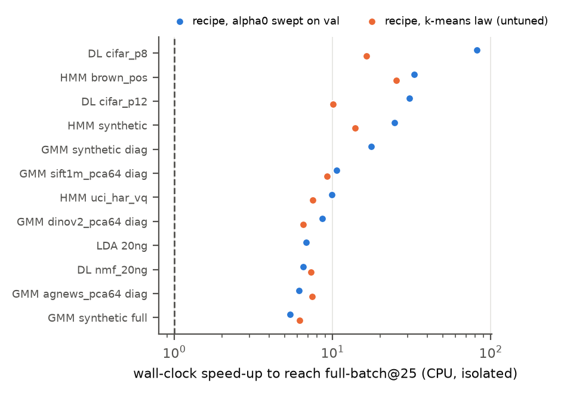
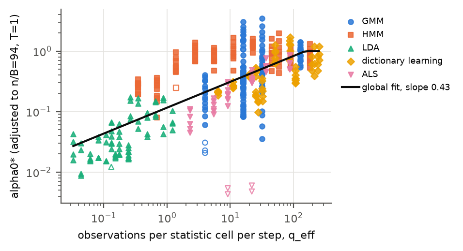

# Scaling laws for stochastic-approximation EM: one recipe and one step-size rule across five model families

*Draft v0 (Markdown), 2026-11-16. Numbers from protocol v3 at commit 225a281; source of record `paper/METADATA.md`
and `PAPER_LOG.md`. References in `paper/references.md`; `TODO` = open item. Authors: TBD.*

---

## Abstract

e-means trains k-means by keeping an exponential moving average (EMA) of each cluster's sufficient statistics,
annealing the rate with a cosine schedule, reviving dead clusters, and setting the initial rate from the problem
size with a fitted law. The update is stochastic-approximation (stepwise) EM, so it applies to any model with a
closed-form M-step. We test the full recipe on five families: Gaussian mixtures, hidden Markov models, latent
Dirichlet allocation, online dictionary learning / NMF, and alternating least squares. The test covers 19 dataset
configurations with 5 seeds and budgets from 0.25 to 25 epochs. We compare against full-batch EM at 25 iterations
and against stepwise / online EM tuned on the same validation grid.

With its rate selected on validation, the recipe reaches the batch objective in under 3 epochs on 12 of 19
configurations (HMM median 38x fewer epochs, dictionary learning 30x). We also give the tuned stepwise baseline
the same revival rule. Against it, the recipe still reaches the batch objective sooner on 16 of 19 configurations
and is never significantly worse outside LDA; on LDA, revival rather than the schedule accounts for the gain. An
ablation shows the two components play different roles. Revival is what makes stochastic EM work where components
die (full-covariance GMMs, LDA). The cosine schedule is what beats tuned step decay where they do not (HMMs,
dictionary learning). On a CPU, matched-quality wall-clock speed-ups reach 5–82x.

The k-means rate law, applied unchanged, transfers to GMM, HMM, dictionary learning and ALS (median validation
penalty ≤ 0.2%) but fails on LDA, whose optimal rate is about 10x lower. One cross-family law beats a per-family
constant (pre-registered; leave-one-cell-out median penalty 0.11% vs 0.32%). Re-expressing it in observations per
sufficient-statistic cell explains two-thirds of the variance of the optimal rate with a single global fit, and cuts
the held-out-family penalty on LDA from 28% to 12% (exploratory).

---

## 1. Introduction

Expectation–maximisation (EM) for latent-variable models with exponential-family complete-data likelihoods touches
the data only through expected sufficient statistics. Replacing the full-data average of those statistics with a
running, step-size-weighted average over mini-batches gives stochastic-approximation EM. This method has several
names and origins: online EM (Sato & Ishii 2000; Cappé & Moulines 2009), stepwise EM (Liang & Klein 2009), and the
natural-gradient step of stochastic variational inference (Hoffman et al. 2013). It is a standard tool for single
families: online LDA (Hoffman et al. 2010), online dictionary learning (Mairal et al. 2010) and mini-batch EM for
mixtures (Nguyen, Forbes & McLachlan 2019). In practice its step-size schedule is tuned per problem; Liang & Klein
already noted that the best schedule "depends on the task and dataset".

e-means (Bessa et al. 2026) revisited this update for k-means at billion scale. It adds three ingredients:
- a **cosine-annealed** rate in place of the usual inverse-time decay (τ0 + t)^−κ;
- a **revival** rule that re-seeds clusters whose EMA mass collapses;
- a **scaling law** that predicts the initial rate α0 and the batch size from (n, k, B, T), fitted on one dataset.

It reports reaching Lloyd's objective in about a tenth of the epochs. The paper calls its update a hard-assignment
form of EM with decayed statistics but tests no other model.

This paper asks whether that recipe, including its law, is a property of stochastic-approximation EM in general or
of k-means. We answer with a pre-registered, cross-family study:

1. **The recipe transfers (C1).** On 12 of 19 configurations across five families, the recipe with α0 selected on
   validation reaches full-batch EM@25 in ≤ 3 epochs. Where it does not (full-covariance GMMs, two LDA corpora,
   ALS), we report how long it takes.
2. **Against the strongest baseline, the schedule matters except on LDA (C2, C2b).** We compare with stepwise EM
   tuned on the same grid *and given the same revival rule*. The recipe is significantly better on 51 of 102
   (configuration, budget) cells, tied on 47 and worse on 4, all on LDA. The ablation separates the components:
   revival rescues stochastic EM on full-covariance GMMs (SIFT1M: 50.7 → 40.5 nats against a batch reference of
   40.7) and LDA. The schedule is the whole advantage on HMMs (up to 10% lower held-out NLL at one epoch) and
   dictionary learning.
3. **Wall-clock (C3).** In an isolated CPU timing pass, matched-quality speed-ups over batch EM@25 are 5.4–82x for
   every configuration that matches within 5 epochs.
4. **The k-means law transfers, except to LDA (C4).** Unchanged, it costs ≤ 0.2% median validation loss on GMM,
   HMM, dictionary learning and ALS. On LDA it never reaches the batch reference.
5. **A cross-family law (C5, pre-registered) and a coordinate that explains the LDA anomaly (C6, exploratory).**
   One law with per-family constants beats per-family constants alone. Written in observations per
   sufficient-statistic cell per step, a single global law explains 66% of the variance of log α0* (vs 20% in the
   k-means coordinates) and shrinks the LDA held-out penalty from 28% to 12%. It is not universal: the exponent on
   observations per cell is 0.43, not 1, and HMMs want the maximum rate despite sparse cells.

We frame the contribution as an empirical and predictive study of stochastic-approximation EM at scale. We make no
claim to a new update rule: the update is stepwise EM, and tuned stepwise EM is our main baseline throughout.

## 2. Related work

**Online / stepwise EM and SVI.** Sato & Ishii 2000; Neal & Hinton 1998 (incremental EM); Cappé & Moulines 2009
(convergence of online EM with Robbins–Monro steps); Liang & Klein 2009 (stepwise EM on four NLP models, 2–10x
over batch EM; the step depends on the task); Hoffman et al. 2010, 2013 (online LDA, SVI); Mairal et al. 2010
(online dictionary learning / NMF); Nguyen, Forbes & McLachlan 2019/2020 (mini-batch EM for exponential-family
mixtures, which lists step and batch tuning as future work). Our update is theirs. We differ in four ways: the
schedule (cosine instead of inverse-time), the revival rule, a time-to-batch protocol across five families, and a
fitted law for the rate.

**Step-size adaptation.** Ranganath et al. 2013 (adaptive learning rate for SVI) removes tuning for one family by
estimating the step online; we instead predict the initial rate from problem coordinates. Chen et al. 2018
(variance-reduced stochastic EM) uses a constant step with control variates and is complementary. Hosseini & Sra
2020 (Riemannian batch and stochastic optimisation for GMMs) is an alternative to EM-style updates.

**Dead components.** Hughes & Sudderth 2013 (memoized online VI with birth/merge moves) is the closest mechanism
to revival in the online-EM literature. k-means codebooks commonly re-seed empty clusters (Faiss; e-means' donor
split). We know of no single dead-component rule applied across EM families.

**Scaling laws and hyperparameter transfer.** Empirical laws for learning rate and batch size in neural network
training are well established: the gradient noise scale (McCandlish et al. 2018), loss scaling laws (Kaplan et al.
2020), and fitted learning-rate and batch-size laws (DeepSeek-AI 2024). Busbridge et al. 2023 show how to scale an
EMA with batch size. The cosine schedule comes from SGD (Loshchilov & Hutter 2017). e-means fitted such a law for k-means on
one dataset. We test whether it transfers across families, and in which coordinates.

**Fast exact kernels.** Flash-KMeans (Yang et al. 2026) and Flash-GMM (Bloch et al. 2026) are fused GPU kernels
that make each exact Lloyd or EM iteration cheaper without storing the N×K distance or responsibility matrix. They
change the cost per pass, not the number of passes. The same kernels would apply to the mini-batch E-step of the
recipe. They are therefore complementary to this paper, which counts passes (epochs to the batch objective) and
reports wall-clock only from a like-for-like CPU implementation of both sides. We did not combine them with either
side. Their GPU speed-ups, if they carry over to the mini-batch E-step, should multiply with the epoch gains
reported here; testing this is future work.

## 3. Method

### 3.1 Stochastic-approximation EM with EMA statistics

Let the complete-data model be in the exponential family with sufficient statistics s(x, z). Batch EM alternates
an E-step, S = (1/n) Σ_i E[s(x_i, z_i) | θ], with a closed-form M-step θ = m(S). The recipe keeps a running
estimate Ŝ and, for each mini-batch b_t of size B, sets

  Ŝ_t = (1 − α_t) Ŝ_{t−1} + α_t · (1/B) Σ_{i ∈ b_t} E[s(x_i, z_i) | θ_{t−1}],   θ_t = m(Ŝ_t).

With α_t = (τ0 + t)^−κ this is stepwise EM; the tuned baseline uses this form. Per family, the statistics are:

| family | EMA statistics | M-step |
|---|---|---|
| GMM (diag / full) | N_j, Σ r_ij x_i, Σ r_ij x_i x_iᵀ (or diagonal) | weights, means, covariances (+ ridge) |
| HMM | expected initial, transition and emission counts (forward–backward) | row-normalise |
| LDA | expected topic–word counts, scaled by D/B (D = training documents), i.e. SVI's global step | λ = η + Ŝ |
| Dictionary learning / NMF | A = Σ α αᵀ, B = Σ x αᵀ (Mairal et al.) | block-coordinate dictionary update |
| ALS | per-item n_i, b_i = Σ r u, A_i = Σ u uᵀ | item factors from the normal equations |

For dictionary learning the M-step is a few passes of block-coordinate descent on the dictionary columns given the
EMA (A, B), with a non-negativity projection for NMF (Mairal et al. 2010).

### 3.2 Cosine schedule

  α_t = α0 · (ε + (1 − ε) · ½ (1 + cos(π t / M))),   ε = 0.1,

where M is the total number of steps in the budget T (in epochs). The baseline schedule decays with t regardless
of the budget. The cosine schedule ties the decay to the budget, keeping the rate high for most of the run and
annealing to ε·α0 at the end.

### 3.3 Revival

Every 5 batches, any unit (mixture component, topic, state, dictionary atom) with EMA mass N_j < 0.1 · mean(N) is
re-seeded by splitting a live donor drawn with probability proportional to its mass: the donor's statistics are
shared and slightly perturbed, as in e-means. One implementation (`core/revival.py`) serves all families. Families without per-component mass (ALS) do not use revival. Statistics start at N = 10⁻¹⁰, so the first
batch effectively initialises them.

### 3.4 Rate laws

- **k-means law (e-means, unchanged):** α0 = min(0.824 · k^−0.46 · B^0.90 · n^−0.45 · T^−0.11, 1), with B from the
  e-means batch law. We call the recipe with this α0 the *law* method (`*_kmlaw`, untuned).
- **Cross-family law M1 (pre-registered, T12):** log α0* linear in log(n/k), log B and log T with per-family
  intercepts, fitted on swept optima across all families. The null M0 is per-family constants only.
- **Per-cell coordinates (exploratory):** q = observations reaching each sufficient-statistic cell per step:
  - GMM: B/k;
  - dictionary learning: B × code density;
  - ALS: B × (ratings per user) / items;
  - LDA and HMM: B × (tokens per document or sequence) / (K·V).

  q_eff replaces V with the effective vocabulary exp(H(unigram)). The global law is
  log α0* = c + a·log q_eff + b·log(n/B) + d·log T.

## 4. Experimental protocol

**Families and data (19 configurations).**

| family | datasets (configurations) | k | test metric | reference |
|---|---|---|---|---|
| GMM | synthetic, SIFT1M-PCA64, DINOv2-PCA64, AG News-PCA64 (MiniLM); diag and full covariance (8) | 32 / 64 | NLL / point (nats) | EM, 25 iterations |
| Dictionary learning / NMF | CIFAR 8×8 patches, CIFAR 12×12 patches, 20 Newsgroups NMF (3) | 128 / 192 / 32 | recon + λ‖α‖₁ | full-batch DL, 25 it. |
| LDA | 20 Newsgroups, Enron, NYTimes (UCI bag-of-words) (3) | 50 | held-out perplexity | batch VB, 25 it. |
| ALS | MovieLens 1M, 10M (2) | rank 32 | test RMSE | ALS-WR, 25 it. |
| HMM | synthetic, Brown POS, UCI HAR (vector-quantised) (3) | 12 states | NLL / token (nats) | Baum–Welch, 25 it. |

**Budgets and seeds.** Budgets T ∈ {0.25, 0.5, 1, 2, 3, 5, 10, 25} epochs; seeds 0–4 for every method and
configuration. Train / validation / test splits are fixed per seed.

**Methods.**
- *swept* (ours): α0 selected on validation per budget from an 8-point log grid on [0.01, 1]. The LDA grid is
  extended below 0.01 where the optimum sat at the floor.
- *law* (ours, untuned): the k-means law.
- *tuned stepwise / online EM* (published prior art): (τ0, κ) from an 18–24-point grid, selected on the same
  validation protocol, without revival.
- *tuned stepwise + revival* (ablation): the same grid and selection plus our revival rule.
- Library defaults as sanity checks: sklearn GaussianMixture and MiniBatchDictionaryLearning, hmmlearn, Hoffman's
  online LDA defaults.

**Long budgets.** At T = 10 and 25 both our method and the baselines search a frozen 3–4-point neighbourhood of
their own T = 5 optimum. This was fixed before any long run (`long_budget_plan.json`).

**Metrics.**
- *Epochs-to-match:* the first, linearly interpolated, epoch at which the seed-mean test curve reaches the seed-mean
  reference@25. Gain = 25 / epochs-to-match.
- 95% CIs by seed bootstrap; paired t-tests by seed (α = 0.05).
- *Law penalty:* relative validation loss of the predicted α0 against the swept optimum, scored leave-one-cell-out
  (LOCO) and leave-one-family-out (LOAO).

**Pre-registration.** Hypotheses, kill criteria and the T12 test were frozen before the runs (`RESEARCH_PLAN.md`,
`scripts/kill_criteria.py`; amendments logged). The revival-equipped baseline and the per-cell refit were added
after seeing results and are labelled as ablation and exploratory.

**Hardware.** One desktop (Ryzen 9 9900X, RTX 5090). GPU ports of the hot loops are float64 and parity-tested; they
change wall-clock only. Headline wall-clock comes from a separate isolated pass: CPU only, 12 threads, one job at a
time, 3 seeds, after warm-up.

## 5. Results

### 5.1 Time to the batch objective (C1)

**Table 1.** Epochs to reach full-batch EM@25 (seed means, 5 seeds; `—` = not within 25 epochs).

| configuration | swept (ours) | law (ours, untuned) | tuned stepwise | tuned stepwise + revival |
|---|---|---|---|---|
| GMM synthetic diag | **0.29** | 17.2 | — | 3.94 |
| GMM synthetic full | **1.98** | 2.88 | — | 23.0 |
| GMM SIFT1M diag | **0.88** | 0.97 | — | 1.64 |
| GMM SIFT1M full | **7.86** | 16.1 | — | 11.8 |
| GMM DINOv2 diag | **1.88** | 2.04 | — | 11.8 |
| GMM DINOv2 full | **8.78** | 23.1 | — | 9.01 |
| GMM AG News diag | 2.54 | **2.04** | — | 4.49 |
| GMM AG News full | **9.63** | 12.0 | — | 16.0 |
| DL CIFAR 8×8 | **≤ 0.25** | 1.68 | 0.54 | 0.54 |
| DL CIFAR 12×12 | **0.83** | 2.83 | 1.66 | 1.66 |
| DL 20NG NMF | **2.32** | 2.36 | 3.70 | 3.70 |
| LDA 20NG | 1.13 | — | 1.60 | **0.89** |
| LDA Enron | **4.44** | — | — | 7.17 |
| LDA NYTimes | — (3242) | — | — (3317) | — (**3198**; ref 3167) |
| ALS ML-10M | **5.84** | 8.88 | 20.1 | n/a |
| ALS ML-1M | — (tie: 0.8656 = ref) | — | — | n/a |
| HMM Brown POS | **0.64** | 0.95 | 1.33 | 1.33 |
| HMM synthetic | **0.66** | 1.44 | 1.95 | 1.95 |
| HMM UCI HAR | **1.72** | 2.21 | 5.70 | 6.73 |

The swept recipe reaches the reference within 3 epochs on 12 configurations:
- all four diagonal GMMs and synthetic full;
- all three dictionary-learning configurations;
- LDA 20NG;
- all three HMMs.

Configurations that take longer:
- Full-covariance GMMs on real data take 8–10 epochs.
- LDA Enron takes 4.4 epochs; on NYTimes no online method reaches batch VB@25 within 25 epochs.
- ALS ML-10M takes 5.8 epochs. On ML-1M every online method ends within 0.0005 RMSE of an already-converged ALS-WR
  (a tie, not a loss).

DL CIFAR 8×8 matches at the first budget (0.25 epochs), so its gain is a floor and we report it as ≤ 0.25 epochs.

*Figure 1:* test objective vs epochs per configuration, all methods (`results/figures/convergence.*`).

### 5.2 Against tuned stepwise EM, and what the gain is made of (C2, C2b)

The published stepwise / online EM baselines have no dead-component handling. Without it, full-covariance GMMs
lose most of their components: 57 of 64 die on SIFT1M. As a result, tuned online EM never reaches the batch
reference on any GMM configuration (SIFT1M full ends at 50.7 nats vs 40.7). Comparing our recipe only against this
baseline would credit the schedule with the effect of revival. We therefore add a baseline with the same
(τ0, κ) grid and validation selection plus our revival rule.

**Table 2.** Recipe (swept) vs tuned stepwise + revival, paired by seed at T ∈ {1, 2, 3, 5, 10, 25}. W / tie / L =
recipe significantly lower / no significant difference / significantly higher (two-sided paired t-test, 4 dof,
p < 0.05).

| family (configurations) | W / tie / L | relative difference (recipe − baseline) |
|---|---|---|
| GMM (8) | 26 / 22 / 0 | −0.03% to −1.5% |
| HMM (3) | 14 / 4 / 0 | −0.05% to −10.3% |
| Dictionary learning (3) | 11 / 7 / 0 | −0.03% to −0.30% |
| LDA (3) | 0 / 14 / 4 | −0.8% to +3.2% |

**Table 3.** Effect of revival on the tuned baseline (test objective at T = 25, seed means).

| configuration | tuned stepwise | + revival | swept (ours) | reference@25 |
|---|---|---|---|---|
| GMM SIFT1M full | 50.68 | 40.53 | 40.50 | 40.67 |
| GMM DINOv2 full | 69.64 | 54.61 | 54.65 | 54.80 |
| GMM AG News full | 78.81 | 70.37 | 70.20 | 70.42 |
| LDA 20NG | 2410 | 2320 | 2334 | 2489 |
| LDA Enron | 2401 | 2240 | 2295 | 2267 |
| LDA NYTimes | 3317 | 3198 | 3242 | 3167 |
| HMM / DL | identical with and without revival (it never fires) | | | |

Three findings follow.

1. **Revival is what makes stochastic EM viable** where components can die. With it, the tuned baseline reaches
   the batch reference on all 8 GMM configurations. On LDA it lowers final perplexity on all three corpora and
   turns Enron from never matching into a match at 7.2 epochs.
2. **With revival on both sides, the cosine schedule still helps on three of four families.** On GMM the margin is
   modest (0.1–1.5%); on real-data full covariance it is significant only at T ≤ 2 and ties afterwards. On HMMs it is
   large and persists to 25 epochs on UCI HAR (−4.5%). On dictionary learning it is small but consistent.
3. **On LDA, a tuned inverse-time schedule with revival is as good or better.** It matches the batch reference
   sooner on 20NG (0.89 vs 1.13 epochs) and ends lower on Enron and NYTimes at T = 25. The recipe's held-out
   perplexity rises from T = 5 to T = 25 on all three corpora (e.g. 20NG 2290 → 2334), and so does batch VB's
   (2456 at 10 → 2489 at 25). A diagnostic rules out the two obvious causes (exploratory; seeds 0–2, k = 50,
   B = 256). Lowering the cosine floor from ε = 0.1 to 0.01 changes validation-selected test perplexity by at most
   7 (20NG T = 25: 2321 → 2328; Enron 2293 → 2290; NYTimes 3235 → 3235 at T = 25), well inside seed spread. Adding
   α0 one step below the long-budget grid does not move the optimum, which stays interior (20NG T = 25: 0.00518,
   val 2466 vs 2569 one step lower). The rise with T is therefore a property of SVI on these corpora rather than of
   the floor or the grid, and we leave its cause open.

Against the strongest baseline, the recipe reaches the batch reference sooner on 16 of 19 configurations (ALS is
compared with stepwise ALS without revival, since neither uses it). It is slower on LDA 20NG, and neither reaches
it on NYTimes or ML-1M.

### 5.3 Wall-clock (C3)

**Table 4.** Isolated CPU timing (12 threads, one job at a time, 3 seeds). Speed-up = reference's 25-iteration
time / time for our method to reach the reference objective. Timed only for matches within 5 epochs.

| configuration | ref@25 (s) | swept | law |
|---|---|---|---|
| DL CIFAR 8×8 | 184 | 82x (≤ 0.25 ep) | 16.4x |
| DL CIFAR 12×12 | 161 | 30.8x | 10.1x |
| DL 20NG NMF | 1.85 | 6.5x | 7.3x |
| HMM Brown POS | 59.4 | 32.9x | 25.3x |
| HMM synthetic | 1.55 | 24.7x | 13.9x |
| HMM UCI HAR | 0.68 | 9.9x | 7.5x |
| GMM synthetic diag | 8.8 | 17.6x | — |
| GMM SIFT1M diag | 25.0 | 10.6x | 9.2x |
| GMM DINOv2 diag | 5.4 | 8.7x | 6.6x |
| GMM AG News diag | 10.7 | 6.1x | 7.5x |
| GMM synthetic full | 20.9 | 5.4x | 6.2x |
| LDA 20NG | 6.0 | 6.8x | — |

*Figure 5:* the same speed-ups on a log scale (`results/figures/timing_speedup.*`).

Wall-clock speed-ups are below epoch gains because a mini-batch epoch has extra per-step overhead (statistic
updates, M-steps after every batch). TODO: time the T = 10/25 matches (GMM full, LDA Enron, ALS ML-10M) if
reviewers want them. TODO: wall-clock for the tuned baselines.

### 5.4 Does the k-means law transfer? (C4)

Applied unchanged, the k-means law costs a median validation penalty of ≤ 0.2% relative to the swept optimum on
GMM, HMM, dictionary learning and ALS. On HMMs the untuned law reaches Baum–Welch@25 before tuned stepwise EM
(0.95–2.2 vs 1.3–5.7 epochs) but ends slightly above it (e.g. Brown 5.215 vs 5.209 nats/token, within one
seed standard deviation).

The law fails on LDA. It predicts α0 ≈ 0.2–1, while the swept optimum is 0.005–0.04 (median 0.029). With the law's
rate, held-out perplexity *worsens* with more epochs, and the batch reference is never reached. The median swept α0*
per family is ALS 0.21, DL 0.26, GMM 0.32, HMM 1.0, LDA 0.029.

*Figure 2:* validation loss vs α0 per budget, law prediction marked (`results/figures/alpha0_sweeps.*`).

### 5.5 One law across families (C5, C6)

**Pre-registered test (C5).** On 422 swept cells, M1 (log-linear in n/k, B, T with per-family intercepts) beats the
per-family-constant null M0:
- leave-one-cell-out median penalty 0.108% vs 0.319%, Wilcoxon p = 1.05 × 10⁻¹⁸;
- leave-one-family-out median 0.338% vs 0.440%.

Held-out-family penalties stay large for LDA (M1 27.7%) and HMM (4.5%).

**Per-cell coordinates (C6, exploratory).** The law's coordinate n/k counts observations per cluster per pass. That
is the right count for k-means and GMMs, but not for models whose statistics are sparse cells: topic–word counts in
LDA and emission counts in HMMs. Counting the observations that reach each statistic cell per step, q_eff, a single
global law (no per-family constants)

  α0* = 0.419 · q_eff^0.427 · (n/B)^−0.282 · T^−0.326

explains R² = 0.66 of the variance of log α0* (vs 0.20 for the same global fit in n/k coordinates). Its
leave-one-family-out median penalty is 0.149%, and it cuts the LDA held-out penalty from 27.7% (M1) to 11.6%. With
per-family constants (Qe1), LOCO is 0.073% and LDA held-out is 5.3%.

The law is not universal:
- The exponent on q_eff is 0.43, not 1, so the recipe does not hold a fixed number of observations per cell in its
  EMA. Observations held at the peak rate range from about 7 (LDA) to about 150 (dictionary learning).
- HMMs want the maximum rate (α0* = 1) despite receiving about one observation per cell per step.

A natural next feature is the fraction of missing information, which theory links to the optimal step of
stochastic-approximation EM (TODO, §7).

*Figure 3:* LOCO / LOAO penalties per law (`results/figures/law_penalties.*`).

*Figure 4:* swept α0* vs observations per statistic cell per step (q_eff), all 422 cells. Each α0* is moved to a
common n/B (94) and T = 1 along the fitted exponents; the line is the single global fit Qe0 (slope 0.43). Hollow =
censored at the grid's lower edge, excluded from the fit. Two things stand out. LDA's low rates fall on the same
trend as the other families once cells are counted per statistic. HMMs (squares) sit far above the line at α0* ≈ 1.
(`results/figures/law_coords.*`)

## 6. Discussion

**What transfers from e-means, and what does not.**
- *The update and the revival rule transfer as they are.* The update was already known to work across families
  (Liang & Klein). The revival rule is the ingredient with the least prior art in online EM, and it decides whether
  online EM works at all on full-covariance mixtures and LDA.
- *The cosine schedule transfers with a family-dependent benefit:* large on HMMs, modest on GMMs and dictionary
  learning, none on LDA.
- *The rate law transfers in form but not in coordinates.* LDA shows that n/k is the wrong variable, and the
  per-cell coordinate is a partial fix.

**When is stochastic EM worth it?** Epoch gains are largest where the batch E-step is expensive and the statistics
are dense relative to the batch: HMMs, dictionary learning, diagonal GMMs. They are smallest where the batch method
is already near convergence after a few passes (ALS ML-1M) or where the statistics are sparse (LDA NYTimes).

**Limitations.**
1. *Datasets.* They are narrower than planned: MovieLens 1M/10M instead of 25M/Netflix; Brown instead of Penn
   Treebank; no PubMed/Wikipedia LDA; no audio dictionary learning.
2. *Reference.* The reference is batch EM at 25 iterations, not converged batch EM. It runs with a like-for-like
   CPU implementation, not with fused GPU kernels such as Flash-KMeans / Flash-GMM (§2).
3. *Long budgets.* They use a frozen 3–4-point local search for all methods.
4. *Wall-clock.* It covers matches within 5 epochs only, on one CPU.
5. *GPU kernels.* We did not combine either side with fused GPU kernels (Flash-KMeans / Flash-GMM); §2 explains
   why they are complementary rather than competing.
6. *Post-hoc analyses.* The revival-equipped baseline and the per-cell law were added after seeing results.
7. *Operational repairs.* All were disclosed and none changed a method: an LDA E-step aliasing bug (all LDA re-run),
   a scheduler bug (73 jobs re-run), 17 HMM jobs re-run after GPU errors, and one ALS cell filled
   (Appendix C).

## 7. Conclusion

Within the scope we tested, the e-means recipe is a recipe for stochastic-approximation EM in general, not only for
k-means. Revival and a budget-aware cosine schedule let a stepwise EM update reach the batch objective in a few
epochs across mixtures, HMMs, dictionary learning, topic models and matrix factorisation. The k-means rate law
carries over to four of five families, and a law in observations-per-statistic coordinates comes closer to one
rule for all five. LDA is the exception throughout. There, a well-tuned inverse-time schedule with revival is as
good, and the optimal rate is an order of magnitude lower than the law predicts. These are the cases a predictive
theory of stochastic EM step sizes will have to explain.

TODO before submission:
- Flash-KMeans / GMM baseline or justification;
- missing-information feature;
- an ε diagnostic on LDA;
- Figures 4–5;
- dataset licences;
- arXiv check for e-means follow-ups.

---

## Appendix (outline)

- **A.** Per-configuration tables with CIs and p-values (`results/<track>/VERDICT.md`), all budgets, all methods,
  library defaults.
- **B.** Hyperparameter grids: α0 grid; (τ0, κ) grids per family; batch sizes; long-budget plans.
- **C.** Deviations and repairs (`PAPER_LOG.md` §2–3).
- **D.** Law fits: coefficients for M0, M1, KM, Q0/Q1, Qe0/Qe1; per-family medians of α0*, q, q_eff; censoring.
- **E.** Compute: ~575 job-hours for protocol v3 plus 273 ablation jobs, one desktop; software versions (`uv.lock`).

## Reproducibility statement

Code, job files and every result record (JSONL, one line per run) are in the repository. Verdict tables and figures
are regenerated by `scripts/evaluate.py` and `scripts/make_figures.py`, and the schedule-vs-revival comparison by
`scripts/compare_rev.py`. Hypotheses and kill criteria were frozen before the runs (`RESEARCH_PLAN.md`), and
amendments are logged in `scripts/kill_criteria.py`.
